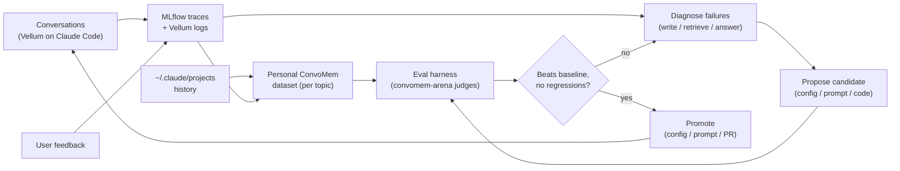

# Vellum-RSI: plan

**Status:** draft plan, nothing implemented yet. Written 2026-11-15.

Vellum-RSI is this fork of Vellum, set up so the assistant's memory system improves itself
in a loop: observe real conversations, measure memory quality with ConvoMem-style metrics
and user feedback, propose a change (config, prompt, or code), test it, and keep it only if
it measurably helps. The aim is a personal assistant whose memory gets better per
personalization **topic**: `tech-learning`, `finances`, `home-care`, `home-buying` and
`business` to start, with more added over time.

The plan has three parts:

1. **Vellum pre-requisites** (this repo): Claude Code as the model provider over ACP, and
   full instrumentation of every conversation and memory decision.
2. **Dataset pre-requisite** (`personalmem-arena`, a local-only sibling project next to
   `convomem-arena`): a ConvoMem-format dataset built from your own Claude Code history.
   Planned separately in `personalmem-arena/docs/personal-dataset-plan.md`. That project
   has no GitHub remote yet, so the plan is only on your machine.
3. **Memory tuning** (this repo + personalmem-arena): the improvement loop itself.



---

## 0. What already exists (verified in this checkout)

| Need | Already in Vellum | Gap |
|---|---|---|
| Talk to Claude Code over ACP | `assistant/src/acp/`: `AcpSessionManager`, agent resolution with bundled `claude`/`codex` profiles, auto-install of the adapter binary, Claude OAuth/token refresh, `model-config.ts` | ACP is used only as a **spawned sub-agent** (`acp_spawn` tool, `/v1/acp/spawn`). It is not a `Provider`, so the main agent and memory jobs can't run on it. |
| Pluggable model providers | `Provider` interface (`assistant/src/providers/types.ts`, `sendMessage`), registry, and **per-call-site routing** (`llm.callSites.<id>.provider`, `providers/call-site-routing.ts`) | No ACP-backed provider. |
| Per-call LLM logging | `llm_request_logs` table: full request/response payloads, `callSite`, latency breakdown (`persistence/schema/infrastructure.ts`) | Stored as raw blobs in SQLite, with no trace tree, no feedback and no experiment tracking. |
| Memory diagnostics | `memory_recall_logs` (memory DB), v3 `selection-log-store.ts` / `pool-log-store.ts`, `memory_recalled` SSE event | Not joined to the answer or to feedback. |
| Memory tuning surface | `substrate/tuning.ts` (dense/sparse weights, BM25 k1/b, consolidation interval/caps, `consolidation_prompt_path`), `v3/tuning-profile.ts` (lane K's, selector, edge lanes, 10-page lean-profile threshold), `prompt-override.ts` | No harness that scores a change. |
| Memory-relevant call sites | `memoryV2Consolidation`, `memoryV3SelectL2`, `memoryRetrospective`, `memoryV2Sweep`, `recall` (`config/schemas/llm.ts`) | Run on whatever the default provider is. |

---

## Part 1: Vellum pre-requisites

### 1.1 Claude Code (Opus 5.5, high effort) as Vellum's provider over ACP

**Goal:** any Vellum call site, and in particular the main agent and the memory call sites,
can run on a Claude Code session using `claude-opus-5-5` at `high` effort, selected per call
site in config.

**The core design problem.** Vellum's `Provider` contract is "give me a completion,
possibly with tool calls that *I* (Vellum's agent loop) execute." Claude Code over ACP is
the opposite: a full agent that runs its own loop and executes its own tools. It streams
`session/update` notifications back and never hands a raw `tool_use` to the client.
Bridging this needs a decision about who owns the tool loop.

**Recommended design: Claude Code owns the loop; Vellum's tools are exposed to it over MCP.**

- New provider `acp` (`assistant/src/providers/acp/`) implementing `Provider`.
- One ACP session per Vellum conversation, reused across turns, managed by the existing
  `AcpSessionManager` (respects `acp.maxConcurrentSessions`).
- On `session/new`, pass an **MCP server that exposes Vellum's tool registry** (`memory`
  tools such as `remember`, plus the rest of Vellum's tools). Claude Code then calls Vellum
  tools through MCP, so Vellum's permissions/approvals stay in force inside Vellum's tool
  executor.
- Turn off Claude Code's own built-in file/shell tools for the assistant role (allow-list
  only the Vellum MCP tools), so the model can't bypass Vellum's sandbox.
- Pass Vellum's assembled system prompt, including the v3 `<memory>` injection and the
  static `<info>` block, as the session's system prompt / turn prefix. **Memory injection
  must stay Vellum's job**, or the memory system being tuned is no longer in the path.
- Map ACP `agent_message_chunk` → Vellum text deltas, ACP tool-call notifications →
  Vellum `tool_progress` events, and the stop reason → `stop-reasons.ts`.
- Model and effort: set `claude-opus-5-5` + `high` through the ACP session config path that
  `acp/model-config.ts` already uses.
- `countInputTokens` is not available, so leave it unset; callers already fall back to the
  local estimator.

**Rollout in three steps, cheapest first:**

1. **One-shot call sites** (no tools): `memoryV3SelectL2`, `conversationTitle`,
   `conversationSummarization`. Each request is a single ACP prompt turn on a fresh or
   pooled session. This proves the transport and the latency budget.
2. **Memory agent call sites**: `memoryV2Consolidation` and `memoryRetrospective`. These are
   background agent runs that write concept pages through file tools, so they need the MCP
   bridge for the page-writing tools.
3. **`mainAgent`**: full chat on Claude Code with Vellum tools over MCP.

Config example for the target state:

```jsonc
"llm": {
  "callSites": {
    "mainAgent":             { "provider": "acp", "model": "claude-opus-5-5", "effort": "high" },
    "memoryV2Consolidation": { "provider": "acp", "model": "claude-opus-5-5", "effort": "high" },
    "memoryV3SelectL2":      { "provider": "acp", "model": "claude-opus-5-5", "effort": "low" }
  }
}
```

**Risks and open questions**

- **Latency:** session start plus Claude Code's own system prompt add time to first token.
  Measure in step 1 before committing `mainAgent`. The v3 selector runs on every turn, so
  it may need a cheaper model even if everything else is Opus.
- **Usage terms and limits (decided: Claude Code only, see Decisions):** all model calls,
  including automated eval and tuning runs, go through Claude Code on your subscription.
  That makes subscription rate limits the main constraint on how fast the loop can run, so
  the plan has to budget for them:
  - a global request budget per tuning run, and `acp.maxConcurrentSessions` of 1–2 for
    eval runs
  - back-off and resume: a run that hits a rate limit pauses and continues later from
    its last finished item, instead of failing
  - Stage A snapshots are cached hard (Part 3.1), so the expensive memory-building runs
    happen rarely
  - cheap call sites (the per-turn selector, topic classifier) at `low` effort, and
    no-LLM metrics (evidence recall) used for most tuning decisions
  - long eval runs scheduled overnight, when you aren't using the subscription
  - re-check the current Claude Code usage terms for this kind of automated use before
    M6. The existing `anthropic` provider stays available as a fallback, with no code
    changes, if limits or terms become a blocker.
- **Double memory:** Claude Code has its own memory (`CLAUDE.md`, auto-memory). Disable it
  for these sessions, or ConvoMem scores will reflect Claude Code's memory instead of
  Vellum's.
- **Alternative if ACP proves awkward:** the Claude Agent SDK, which gives a programmatic
  agent loop with custom tools in-process. Keep the `Provider` boundary the same so the
  choice can be swapped.

**Done when:** a Vellum chat on `mainAgent = acp` can call `remember`, the next turn
shows a v3 `<memory>` injection, and the turn appears in `llm_request_logs` with
`provider = acp`.

### 1.2 Instrument and store every chat (MLflow)

**Goal:** every turn, memory decision, background memory job and piece of feedback is
recorded in one place that can be queried, joined and used to score candidates.

**Why MLflow fits:** MLflow 3 Tracing records trace trees (spans with inputs, outputs and
timing), has a TypeScript tracing SDK built on OpenTelemetry, and supports **assessments**
(human feedback and LLM-judge scores attached to a trace). MLflow also does
experiment tracking (runs, params, metrics, artifacts), which the tuning loop needs anyway.

**Storage:** MLflow stores traces and runs in its **backend store**, which is a SQL
database (SQLite or Postgres) out of the box, with large payloads in an artifact store.
A separate database is **not** needed for v1. Use:

```bash
mlflow server --backend-store-uri sqlite:///$HOME/.vellum-rsi/mlflow.db \
  --default-artifact-root $HOME/.vellum-rsi/mlartifacts --host 127.0.0.1 --port 5000
```

Move to Postgres only if you start running SQL joins across Vellum's own tables and MLflow
data. Vellum's SQLite stays the system of record. MLflow is the analysis copy.

**Trace shape (one trace per user turn):**

```
turn  (conversationId, messageId, topic, memoryTier, configHash, gitSha)
├─ memory.retrieve          lanes → pool → selector → injected sections (+ token count)
│  ├─ lane.<name>           candidates with scores
│  └─ llm.memoryV3SelectL2
├─ llm.mainAgent            request/response (redacted), latency breakdown
│  └─ tool.<name>           e.g. tool.remember with the saved fact
└─ assessments              user thumbs/correction, judge scores, evidence recall
```

Background jobs (`memory_v2_consolidate`, `memory_v3_maintain`, retrospective) get their
own traces, linked by `conversationId` and the buffer entries they consumed. This makes
"the fact was said → buffered → filed into page X → retrieved on turn Y" traceable end to end.

**Implementation:**

- A small `assistant/src/telemetry/mlflow/` module: OTel exporter config, span helpers,
  and redaction. No-op when `telemetry.mlflow.enabled` is false.
- Spans are emitted from the code that already writes `llm_request_logs`,
  `memory_recall_logs` and the v3 selection/pool logs, so there's one hook per existing log.
- **Feedback capture:** thumbs up/down, a free-text correction and a "you forgot X"
  action in the chat UI. Store each in a local table and as an MLflow assessment on the
  turn's trace.
- **Implicit feedback:** an LLM pass over recent turns flags corrections ("no, I said…"),
  repeated questions and abstentions, and logs them as assessments with
  `source = auto`.
- **Backfill:** a one-off script that replays existing `llm_request_logs` rows into MLflow.
- **Redaction:** secrets, account numbers and financial amounts are replaced with
  placeholders before export, using the same reversible scheme and private value store as
  the dataset (personalmem-arena plan, step 3). MLflow listens on localhost only, and nothing
  leaves the machine.

**Done when:** one chat turn shows up in the MLflow UI as a trace with the
retrieve/agent/tool spans, a thumbs-down in the UI appears as an assessment on it, and a
consolidation run is visible as its own linked trace.

### 1.3 Topics as a first-class concept

The tuning targets are per topic, so Vellum needs to know which topic a turn belongs to.

- A topic registry (`~/.vellum-rsi/topics.yaml`): id, description, example phrases. Adding a
  topic is a registry edit, not a code change. The same file drives dataset labeling in
  personalmem-arena.
- A cheap per-turn topic classifier, multi-label with an `other` label. It writes `topic` onto the trace
  and the conversation.
- Optional later step (a harness-level candidate, Part 3): topic-aware memory, such as
  topic tags on concept pages, a topic lane, or per-topic consolidation guidance.

---

## Part 2: Dataset pre-requisite (summary)

Planned in detail in the local-only `personalmem-arena` project
(`personalmem-arena/docs/personal-dataset-plan.md`). In short: parse
`~/.claude/projects/**/*.jsonl` into user/assistant dialogue, split it into episodes,
redact it, label episodes by topic, generate questions for the six ConvoMem categories
with evidence pointers, validate them, and write them in ConvoMem's file layout.
personalmem-arena then exposes the dataset as its own verifiers environment, reusing
convomem-arena as a library (`EvidenceStream` / `mix()` / judges) with convomem-arena
itself left unchanged.
Once Vellum is instrumented, Vellum's own conversations become a second source for the
same pipeline.

---

## Part 3: Memory tuning (the RSI loop)

### 3.1 Evaluation harness

This supersedes `benchmarking/assistant-benchmarking-dimensions.md` §6a, which needs these
corrections for v3:

- Wait on `memory_v2_consolidate`, `memory_v2_reembed` and `memory_v3_maintain`, not
  `graph_extract` / `embed_segment`. Those are v1 jobs and are suppressed under the
  substrate.
- Replaying turns does not write memory by itself. Memory is written only when the agent
  calls `remember` or `memory.substrate.sweep_enabled` is on. Consolidation then runs on
  an 8h interval or at 100 buffer lines, so force it with `POST /v1/consolidation/run-now`.
- v3 recall is an automatic `<memory>` injection, not a tool call. Read the injected
  sections from the v3 selection log (or the new MLflow span) instead of a `recall`
  `tool_result`.
- Below 10 concept pages (`MEMORY_V3_FULL_PROFILE_MIN_PAGES`) v3 runs the lean profile
  (no dense lane, no selector). Small histories never exercise the full retrieval path, so
  either use contexts large enough to cross it or report the two profiles separately.

**The harness has two stages, so the expensive half is cached:**

- **Stage A, build memory (slow, cached):** for each dataset history: start a fresh
  instance (`vellum hatch --disable-platform`), replay the conversations as real turns,
  force consolidation, wait for the jobs to finish, and **snapshot the workspace**. The
  cache key is `(history id, write-path config hash, git sha)`.
- **Stage B, recall and answer (fast, repeatable):** restore the snapshot, apply a recall
  config, ask each question, and score it. Only re-run Stage A when a candidate changes
  the write path.

**Metrics, all recorded per topic × ConvoMem category:**

| Metric | What it isolates | Cost |
|---|---|---|
| **Evidence recall@injection**: share of evidence conversations whose content appears in the injected `<memory>` sections | Saving + retrieval, with no answering model involved | Cheap, no LLM |
| **Write recall**: share of evidence facts that exist anywhere in concept pages after Stage A | Saving only (did consolidation keep the fact?) | Cheap (string/LLM match) |
| **Judged accuracy**: convomem-arena `judge_for(category, …)` RIGHT/WRONG | End-to-end | Judge call |
| **Abstention precision**: correctly says "not mentioned" | Over-recall or hallucination | Judge call |
| **Injection cost**: tokens injected per turn, selector latency | Efficiency guardrail | Free (from traces) |
| **Online**: thumbs-down rate, correction rate, "you forgot" rate per topic | Real-world quality | From MLflow assessments |

The low-vs-high evidence-recall split (borrowed from convomem-arena's `tools` mode) tells
a **memory failure** (evidence never injected) apart from an **answering failure**
(evidence injected, answer still wrong). Only memory failures are targets for memory
tuning.

### 3.2 What gets tuned, cheapest first

1. **Config parameters**, by black-box search (Optuna-style) over Stage B:
   `dense_weight`, `sparse_weight`, `bm25_k1`, `bm25_b`, `ann_candidate_limit`, the v3 lane
   sizes (`hotSetK`, `freshSetK`, `needleK`, `denseK`, `spanQueryK`, edge caps), and
   `selectorEnabled`. Write-path parameters (`sweep_enabled`, consolidation caps) need
   Stage A per trial, so search those on a small subset.
2. **Prompts**, by reflective prompt optimization (the GEPA / "optimize-anything" style:
   an LLM reads failing traces and judge feedback, proposes a revised text, and the
   harness scores it):
   - the consolidation prompt (`consolidation_prompt_path`). This is the biggest lever on
     write recall.
   - the v3 selector prompt (`memoryV3SelectL2`)
   - the `remember` tool description and the system guidance on *when* to remember
   - the retrospective prompt and the per-topic consolidation guidance
3. **Harness-level changes**, proposed as code: topic-aware page tagging, a topic lane,
   changes to how sections are split, new lanes, or different scoring. Claude Code (the same
   Opus 5.5 that runs Vellum) proposes a patch in a git worktree, runs the unit tests and the
   memory-tier boundary guard test, and runs Stage A+B. A passing candidate becomes a PR
   for **your** review. Code changes are never merged automatically.

### 3.3 The loop

Each iteration is one MLflow experiment run (params = candidate, metrics = harness
scores, artifacts = prompt text or diff).

1. **Observe:** pull the last N days of traces and assessments. Re-run dataset generation
   on new conversations (incremental).
2. **Diagnose:** cluster failures by topic × category × failure type (write miss,
   retrieval miss, answer miss, over-injection). Pick the largest memory-failure cluster.
3. **Propose:** generate k candidates at the cheapest level that could fix that cluster
   (config → prompt → code).
4. **Evaluate:** Stage B on the **dev** split, plus Stage A if the write path changed.
5. **Gate:** promote only if the candidate
   - beats the current baseline on the target cluster by a set margin, with repeated
     seeds to separate signal from noise
   - shows no significant regression on any other topic or category (the per-topic
     guardrail that keeps `finances` from getting worse while `tech-learning` improves)
   - stays within the injection-token and latency budgets
   - passes the existing test suite (code candidates)
6. **Promote:** config and prompt changes are committed to a `vellum-rsi` config
   directory, and code goes up as a PR. Only then is the **test** split run, and the result
   recorded. Baseline = the promoted candidate.

### 3.4 Guardrails (the parts that keep "self-improvement" honest)

- **The evaluator is frozen.** Candidates can't modify the judges, dataset, harness or
  metrics. Those change only by your commit, and the loop refuses to run when they're dirty.
- **The test split is held out.** Tune on dev, report on test, and refresh test
  periodically from conversations newer than anything the tuner has seen.
- **Judge independence:** where possible the judge model differs from the candidate
  generator, and a sample of judge calls is checked by hand each cycle.
- **Budget caps** on each run for tokens and wall-clock, and a kill switch.
- **Rollback:** every promoted change records its baseline, and one command restores it.
- **Privacy:** all data stays local (`~/.vellum-rsi/`). The dataset and MLflow store are
  never pushed to a remote or a hub.

---

## Milestones

| # | Milestone | Done when |
|---|---|---|
| M1 | ACP provider, one-shot call sites | **Done 2026-11-16** (branch `vellum-rsi-m1-acp-provider`): the selector, titles and summaries run on the `claude-code` provider; see "M1 results" |
| M2 | MLflow tracing + feedback | A turn appears as a trace with retrieve/agent/tool spans and a UI thumbs-down assessment |
| M3 | Personal dataset v0 | `vf-validate personalmem-arena` passes on the local dataset (see personalmem-arena plan) |
| M4 | Stage A/B harness | Baseline scores per topic × category with snapshot caching |
| M5 | ACP provider, memory agents + main agent | Consolidation and chat run on Opus 5.5 high via ACP |
| M6 | Loop v1: config + prompt tuning | One promoted candidate with a dev gain and no test regression, logged in MLflow |
| M7 | Loop v2: harness-level proposals | Claude Code opens a memory-code PR that passes the gate |
| M8 | Online loop | Weekly run driven by new conversations and feedback |

M1–M2 and M3 are independent and can run in parallel.

## M1 results (2026-11-16)

**What was built** (`assistant/src/providers/claude-code/`): a keyless `claude-code`
provider (catalog models `opus` / `sonnet` / `haiku`, Claude Code's own aliases).
The design differs from 1.1's "Claude Code owns the loop" target, because M1 only needs
completions:

- One shared `claude-agent-acp` process. Each call opens a fresh ACP session with `_meta`:
  - `systemPrompt`: Vellum's prompt replaces Claude Code's
  - `disableBuiltInTools: true`
  - `claudeCode.options.settingSources: []`, so the user's `~/.claude` settings,
    CLAUDE.md and Claude Code memory never load

  The session is pinned to the profile's model and effort, prompted, and always closed.
  Token usage comes from the ACP prompt response.
- **Forced single-tool calls are emulated:** the model is asked for JSON matching the tool
  schema, and the reply is returned as a `tool_use` block. This is how the v3 selector
  (`tool_choice` on `select_pages`) works unchanged. Open tool use is refused with a clear
  error until M5.
- Credentials come from the existing ACP spawn path (`acp/claude_oauth_token` in the
  assistant vault).

**Live test** on `vellum-rsi-m1` (hatched from the M1 worktree, `--disable-platform`):
chat stays on `qwen-local` (Ollama), and `memoryV3SelectL2`, `conversationTitle` and
`conversationSummarization` are routed to a `claude-opus` profile (Opus, effort `high`).
Twelve fictional concept pages were ingested so v3 leaves its under-10-page lean profile
and runs the selector.

| Measurement | Result |
|---|---|
| Direct `inference send` × 4 (wall time, including ~1 s CLI start) | 3.8 / 5.9 / 3.8 / 4.0 s, all correct |
| v3 selector (`memoryV3SelectL2`) on a chat turn | **~4.3 s**, `selector_ran = 1`, 162 candidates → 3 chosen; the JSON parsed into a valid selection |
| Conversation title | ~3.4 s, title generated |
| Main reply (qwen, for comparison) | 27.8 s |

**Findings:**

- **The selector sits on the time-to-first-token path:** about 4.3 s at Opus/high before the
  main model starts. Before M5 moves chat to Claude, try the selector at `low` effort or on
  `sonnet` / `haiku` (a separate profile), and measure again.
- **A first memory-quality miss, of the `changing_facts` kind.** Asked "what is my grocery
  budget now and what was it before?", the pool held the page lead and its `Budget` section
  (needle and dense lanes), but **not** its `History` section (520 → 640). So the answer
  had the current value and correctly said memory had no earlier one. The selector chose
  well from what it was offered; the gap is in section-level retrieval. This is an early
  test case for the tuning loop (Part 3).
- **Noise, not failure:** Vellum's ACP code logs every adapter stderr line at ERROR
  (`[session/create] … phase=settings`). Worth downgrading before MLflow traces count
  errors.
- **Pre-existing config gap:** the background `memoryRetrospective` agent routes to a
  seeded Anthropic profile whose connection doesn't exist on this instance, so it fails
  with `ConnectionResolutionError`. It is a tool-using agent run, so M1 can't take it;
  route it to `qwen-local` for now, and to `claude-code` in M5.
- **Not covered by M1:** ACP calls don't write `llm_request_logs` rows (only
  conversation-model calls do), so their timings come from daemon logs and the provider's
  `rawResponse.timings`. Request-level tracing of these calls is M2's job.

## Decisions (2026-11-15)

- **Model access: Claude Code only.** Every call site, including automated eval and
  tuning runs, runs on Claude Code (Opus 5.5) over ACP on your subscription. `mainAgent =
  acp` is the long-term state, not a dev convenience. Rate limits are handled by the
  budgeting rules in 1.1.
- **Topics:** `tech-learning`, `finances`, `home-care`, `home-buying`, `business`.
  `home-buying` and `business` are separate topics, not folded into others.
- **Financial amounts:** redacted in the dataset and traces, with the real values kept in
  a private local database that can restore them (details in the dataset plan, step 3).
  The same applies to anything exported to MLflow (1.2).
- **Raw transcripts:** only a local model (Ollama) reads unredacted text, for
  redaction and topic labeling. Opus 5.5 only sees redacted text.
- **History retention:** `cleanupPeriodDays` raised to 3650, and a raw snapshot taken
  at `~/.convomem-personal/raw/2026-11-15/` (dataset milestone P0 done).

## Open questions

- Should topic be inferred per turn, or set per conversation by the user?
- How much synthetic augmentation is acceptable while real `finances`, `home-care` and
  `home-buying` history is still thin?
- Which memory tier the eval pins: v3 only (recommended, per `memory/AGENTS.md` v1/v2 are
  being retired).
